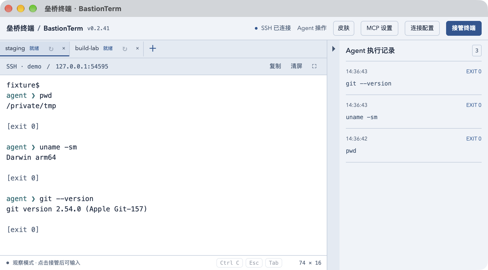

# BastionTerm · 垒桥终端

**让 AI Agent 在只开放交互式 SSH 的堡垒机上工作，你可以看着它执行，也可以随时接手。**

BastionTerm gives your agent and your terminal the same SSH shell. It works with bastions that allow an interactive PTY but disable SSH exec channels. Open a host tab, follow the output, and take over when a command needs your input. Agents connect over MCP.

普通 Agent 常用 `ssh host command`。有的堡垒机允许用户登录，却拒绝这种远程执行请求。垒桥终端沿用你的账号和访问权限，在已登录的交互式 shell 中发送命令并读取结果。同一台主机保留工作目录和环境，不同主机独立接管、交还。

**和 Warp 比，哪里更顺手？** 在我们日常使用的交互式堡垒机上，最省事的是交接。Agent 执行到一半需要人工处理时，你在同一标签里接手，处理完再交还，双方都能看到刚才发生了什么。

[下载 macOS 或 Windows 版本](https://github.com/jichengwei001/bastionterm/releases) · [MCP 配置与 Agent 提示词](MCP配置与Agent提示词.md)

## 三步开始

1. 解压对应平台的发布包，打开 BastionTerm，点「连接配置」添加你有权访问的 SSH 主机。
2. 登录后点「MCP 设置」，把生成的配置合并到 Agent 客户端，重新加载客户端。
3. 告诉 Agent「在刚配置的主机运行 `pwd`」。你会看到实时输出，点「接管终端」即可操作同一个 shell。

## 使用桌面终端

- **切换主机**　每个标签对应一条独立的 SSH 会话。点右侧小三角可查看当前主机的 Agent 执行记录。
- **接管与交还**　点「接管终端」会中断当前前台命令，随后由你输入。处理完、退出交互程序后，点「交还 Agent」即可继续使用同一个 shell。
- **重连与退出**　标签上的 ↻ 重新登录并打开新 shell。关闭桌面窗口会最小化。要断开所有 SSH，请在 Windows 点右侧「退出」，在 Mac 按 ⌘Q。

[快捷键、全屏、复制粘贴及故障排查](docs/desktop.md)

## 本机文件

- macOS 使用 `~/Library/Application Support/BastionBridgeGPUI/`。
- Windows 使用 `%LOCALAPPDATA%\BastionBridgeGPUI\`。
- `profiles.json` 保存配置元数据，`credentials.json` 保存选择记住的明文密码，`known_hosts` 保存首次接受的主机密钥。Unix 配置文件权限为 0600。早期 GPUI 格式的密码会在首次读取配置时迁移。使用 `BASTION_GPUI_HOME` 可指定独立目录。
- `sessions.json` 只保存标签和目标，后台重启后显示为断开。分享时请分发发布包。

## 源码构建

桌面界面使用原生 GPUI。SSH、存储、HTTP 服务和 stdio MCP 使用 Rust。浏览器入口内嵌原版页面与 xterm.js，运行桌面程序不需要 Node、Python 或 WebView。

macOS 需要 Rust 和 Xcode Command Line Tools，执行 `cargo build --release --locked` 后运行 `sh scripts/package-macos.sh`。打包脚本另需 Python 3 生成依赖声明。Windows 需要 Rust MSVC、Visual Studio C++ Build Tools 和 Windows SDK（含 fxc.exe），在源码目录的 PowerShell 中执行 `.\scripts\package-windows.ps1`。使用 release 构建以将 Windows 图形着色器编入程序。测试命令为 `cargo test --locked`。

## 许可

原创代码采用 [MIT](LICENSE)。字体、终端组件和第三方源码的许可见 [第三方声明](THIRD-PARTY.md)。
